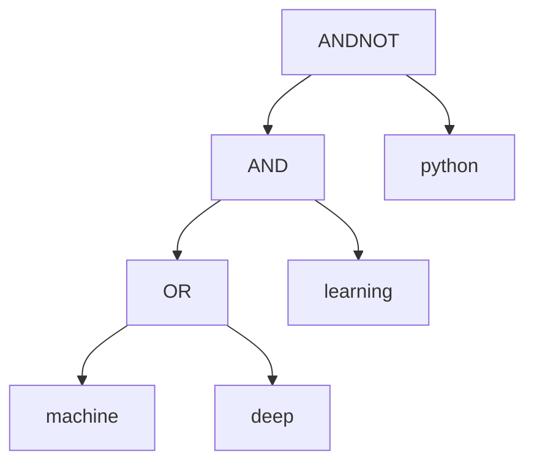

# Как работает поисковик

У поисковика две основные задачи. Сначала он один раз читает документы и строит индекс. Затем он
много раз отвечает на запросы, используя уже готовые файлы индекса. При запуске `search` заново
читать весь корпус не нужно.

## Слово ведёт к документам

Представим четыре маленьких документа. Числа слева — внутренние номера, которые назначила программа:

|  ID | Текст                     |
| --: | ------------------------- |
|   0 | Machine learning          |
|   1 | Deep learning with Python |
|   2 | Machine and Python        |
|   3 | пустой документ           |

После выделения слов и приведения регистра программа знает, в каких документах встречается каждое
слово. Покажем четыре таких списка:

```text
machine  → [0, 2]
learning → [0, 1]
deep     → [1]
python   → [1, 2]
```

Это и есть **инвертированный индекс**: по слову сразу получаем номера подходящих документов. Он
похож на предметный указатель в книге, где около слова перечислены номера страниц.

Одна запись списка хранит номер документа и признаки полей, где встретилось слово: заголовок,
подзаголовки или основной текст. В коде это структура `Posting`; на диске запись занимает пять байт.
Если слово повторено в документе сто раз, номер документа всё равно записывается один раз: для
такого поиска достаточно знать, что слово есть. Длина списка, обозначенная в коде как `df`, равна
количеству документов с этим словом. У `machine` в примере `df=2`.

## Как документ превращается в слова

`CorpusReader` читает архив небольшими блоками. Он может распаковывать очередной gzip
непосредственно внутри tar и собирать из байтов отдельные строки JSONL. В строке лежит один документ
с полями `docid`, `title`, `headings`, `body`, `url`.

`TextAnalyzer` выделяет слова из title, headings и body. `Machine, MACHINE!` превращается в два
слова `machine`. Текст UTF-8 разбирается по символам Unicode, поэтому кириллица и многобайтовые
буквы обрабатываются корректно. Затем повторения объединяются и сохраняются признаки полей. URL
сохраняется для показа в результатах поиска.

Точно такая же обработка применяется к словам запроса. За счёт этого `MACHINE` в запросе находит
`Machine` в документе. Разные формы слова не объединяются: `machine` и `machines` остаются разными
словами.

Исходный docid может быть длинной строкой MS MARCO. Для списков программа назначает короткий
внутренний номер 0, 1, 2 и далее. Отдельное хранилище связывает этот номер с исходным docid,
заголовком и URL.

## Почему корпус не занимает всю оперативную память

В памяти накапливается таблица слов только текущей порции документов. Когда выделенной для сегмента
памяти перестаёт хватать, `IndexBuilder` записывает таблицу на диск и освобождает занятую ею память.
Получается небольшой самостоятельный индекс — **сегмент**. Потом начинается следующий.

Чтение, анализ текста и накопление индекса могут идти одновременно. Очередь между этими этапами
ограничена: если анализ или запись отстают, чтение ждёт свободного места. Анализаторов несколько, но
их результаты принимаются в порядке исходных документов. Поэтому порядок завершения обработки не
меняет номер документа.

Номера сквозные: первый сегмент может содержать документы 0–999, второй — 1000–1999. После записи
сегментов их объединяет функция `merge_segments()`. Термы в каждом сегменте отсортированы, поэтому
достаточно сравнивать текущие слова сегментов в том же порядке, что используется в словаре, и
выбирать минимальное.

Когда одно слово встречается в нескольких сегментах, его списки соединяются в порядке сегментов.
Например, `[0, 2]` и `[1003, 1007]` превращаются в `[0, 2, 1003, 1007]`. Номера уже идут по
возрастанию; перенумеровывать документы не требуется. Списки копируются небольшими блоками через
один и тот же буфер — участок памяти для временно прочитанных данных. Слишком много сегментов
объединяются за несколько проходов с ограниченным числом открытых файлов.

## Что происходит с запросом

Возьмём запрос:

```text
((machine OR deep) AND learning) ANDNOT python
```

Сначала программа выделяет слова, операции и скобки. Затем `QueryParser` строит дерево, которое
задаёт порядок действий:



Скобки задают группы. Без них AND и ANDNOT выполняются раньше OR; равноприоритетные операции
группируются слева. Ошибка вроде `machine AND` обнаруживается парсером до исполнения.

Для нашего маленького корпуса смысл запроса такой:

1. `machine OR deep` даёт документы `[0, 1, 2]`: достаточно любого из слов.
2. Добавление `AND learning` оставляет `[0, 1]`: слово learning тоже обязательно.
3. `ANDNOT python` исключает документ 1. Остаётся `[0]`.

В программе каждая операция передаёт следующей операции подходящие номера по одному. Написанные выше
промежуточные списки нужны для объяснения; во время поиска целые массивы для них не строятся.

## Как операции обходят списки

**Итератор** — курсор, который помнит текущую позицию в отсортированном списке. Он умеет сообщить
текущий номер, перейти к следующему результату или к первому номеру не меньше заданного.

Для AND сравниваются текущие номера двух курсоров. Если первый курсор указывает на 2, а второй — на
100, искать документ 2 во втором списке уже незачем: все дальнейшие номера там не меньше 100. Первый
курсор можно сразу подвести к номеру не меньше 100. Совпавший номер выдаётся как результат
пересечения.

OR выбирает меньший текущий номер. Если номера равны, выдаёт документ один раз и двигает оба
курсора. ANDNOT перебирает левый список и пропускает номера, которые есть в правом.

Ускоренный `advance(target)` сначала проверяет позиции на расстоянии 1, 2, 4, 8 и далее, пока не
ограничит нужный участок списка. Затем бинарным поиском находит внутри него первое значение не
меньше target. Например, в `[3, 8, 15, 42, 70, 120, 300, 900]` вызов `advance(100)` находит 120. При
коротких прыжках обычный последовательный проход тоже может быть выгоден, поэтому в проекте
сохранены оба режима.

У каждого слова в дереве запроса есть свой курсор. Операции соединяют результаты подвыражений,
выдавая подходящие номера по одному. Если нужны только первые десять документов, поиск
останавливается на десятом. Все остальные совпадения вычислять не требуется.

## Как читается большой индекс с диска

Индекс разделён на несколько файлов:

- словарь связывает слово с адресом и длиной его списка;
- `postings.data` содержит отсортированные номера документов и признаки полей;
- отдельное хранилище связывает номер документа с исходным docid, заголовком и URL.

Словарь отсортирован. Отдельная таблица смещений позволяет найти слово бинарным поиском и сразу
узнать, где начинается его список.

Файлы открываются через `mmap`. Это даёт программе адреса, по которым доступны байты файла, а
операционная система подгружает нужные страницы по мере обращений. Само отображение файла на 31 ГБ
не означает немедленного занятия 31 ГБ оперативной памяти.

Получив номера подходящих документов, программа читает сохранённые сведения о них. У каждого
документа есть восьмибайтовая запись со смещением: адрес нужной записи находится по формуле
`doc_id * 8`. Поэтому для десяти результатов можно получить десять заголовков и URL, не перебирая
весь корпус и не открывая его gzip-файлы.

## Что считается результатом

Поиск возвращает документы, которые удовлетворяют записанному условию, по возрастанию внутренних
номеров. Он не сортирует их по смысловой близости к запросу. Поэтому первое совпадение означает
первый подходящий документ в порядке корпуса.

Сохранённые файлы содержат всё необходимое для повторного открытия. Команда `search` читает готовый
индекс. Команда `validate` отдельно проходит по всем записям и проверяет структуру; обычный запрос
такого полного прохода не делает.

## В каком порядке читать исходники

1. [analyzer.cpp](../src/analyzer.cpp) — как текст разбивается на слова и сохраняются признаки
   полей.
2. [query.cpp](../src/query.cpp) — как запрос превращается в дерево и соединяет курсоры.
3. [index.cpp](../src/index.cpp) — переходы по спискам, сегменты, очередь документов и объединение
   сегментов.
4. [storage.cpp](../src/storage.cpp) — формат записей, доступ к файлам через память и сведения о
   документах.
5. [corpus.cpp](../src/corpus.cpp) — чтение JSONL и gzip внутри tar.
6. [tests.cpp](../tests/tests.cpp) — сравнение движка с простым полным перебором.
